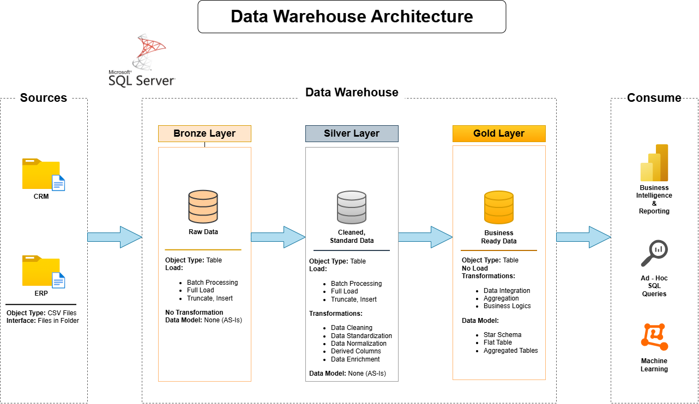

# SQL Data Warehouse Project

## 📌 Overview

This project demonstrates the design and implementation of a modern **SQL Server Data Warehouse** that integrates sales data from two source systems (ERP and CRM) into a centralized analytical environment.

The project follows the Medallion Architecture (Bronze, Silver, and Gold layers) to build a structured data pipeline, transform raw data into meaningful information, and generate business insights using SQL.

The ultimate goal is to provide a reliable foundation for data analysis and support data-driven business decision-making.

---

## 🏗️ Data Warehouse Architecture

The project follows a three-layer Medallion Architecture:



### Architecture Layers

- **Bronze Layer:** Stores raw data imported directly from ERP and CRM CSV files.
- **Silver Layer:** Cleans, standardizes, validates, and integrates data from different source systems.
- **Gold Layer:** Contains business-ready data models, including fact and dimension tables, optimized for analytical queries and reporting.

---

## 🎯 Project Objectives

- Design and develop a modern data warehouse using SQL Server.
- Integrate data from multiple source systems (ERP and CRM).
- Implement ETL pipelines to extract, transform, and load data.
- Identify and resolve data quality issues.
- Develop a unified data model using fact and dimension tables.
- Perform SQL-based analysis to extract meaningful business insights.
- Document the data architecture and data models.

---

## ⚙️ Technologies Used

| Technology | Purpose |
|---|---|
| SQL Server | Data warehouse development |
| SQL | Data extraction, transformation, and analysis |
| SQL Server Management Studio (SSMS) | Database management and query execution |
| CSV Files | Source data |
| Git & GitHub | Version control and project documentation |
| Draw.io | Architecture diagram design |

---

## 🔄 ETL Process

The project implements an ETL workflow to move data from source systems into the data warehouse.

### 1. Extract
- Import customer, product, and sales data from ERP and CRM CSV files.
- Load source data into the Bronze layer.

### 2. Transform
- Clean and standardize the raw data.
- Handle missing values, duplicates, and inconsistent formats.
- Resolve data quality issues.
- Integrate ERP and CRM datasets.

### 3. Load
- Load transformed data into the Silver layer.
- Build business-ready fact and dimension tables in the Gold layer.
- Prepare the final data model for analytical queries.

---

## 🥉 Data Warehouse Layers

| Layer | Description |
|---|---|
| Bronze | Stores raw source data without major transformations. |
| Silver | Stores cleaned, standardized, and integrated data. |
| Gold | Stores business-ready data models for reporting and analytics. |

---

## 📊 Data Modeling

The Gold layer follows a dimensional data modeling approach using a Star Schema.

- **Fact Tables:** Store measurable business data, such as sales transactions and sales amounts.
- **Dimension Tables:** Store descriptive information about customers, products, and other business entities.

This structure simplifies analytical queries and improves reporting efficiency.

---

## 📈 SQL Analytics & Reporting

SQL scripts are developed to answer important business questions and generate insights in three major areas:

### 1. Customer Behavior
- Identify customer purchasing patterns.
- Analyze customer distribution and segmentation.
- Understand customer contribution to overall sales.

### 2. Product Performance
- Identify top-performing products.
- Analyze product-wise sales and revenue.
- Evaluate product demand and contribution.

### 3. Sales Trends
- Analyze sales performance over time.
- Identify revenue trends and patterns.
- Compare sales across different periods.

---

## 📁 Repository Structure

```text
sql-datawarehouse-project/
│
├── datasets/             # ERP and CRM source CSV files
├── docs/                 # Architecture diagrams and documentation
├── scripts/
│   ├── bronze/           # Raw data ingestion scripts
│   ├── silver/           # Data cleansing and transformation
│   └── gold/             # Analytical data models
├── tests/                # Data quality and validation tests
├── README.md             # Project documentation
└── LICENSE               # MIT License
```

---

## 🚀 Key Features

- Multi-source data integration (ERP and CRM).
- Three-layer Medallion Architecture.
- SQL-based ETL pipeline implementation.
- Data cleansing and quality management.
- Dimensional data modeling using Star Schema.
- Business-focused SQL analytics.
- Structured and documented data warehouse design.

---

## 🔮 Future Enhancements

- Automate ETL pipeline execution.
- Integrate Power BI for interactive dashboards.
- Implement incremental data loading.
- Add advanced data quality monitoring.
- Extend analytics with predictive modeling.

---

## 📚 Learning Outcomes

Through this project, I gained practical experience in:

- Data warehouse architecture and design.
- ETL pipeline development using SQL.
- Data integration and transformation.
- Data cleansing and validation.
- Fact and dimension table modeling.
- Writing analytical SQL queries.
- GitHub-based project documentation and version control.

---

## 🛡️ License

This project is licensed under the [MIT License](LICENSE).

---

## 👩‍💻 About Me

**Diya Santosh Mokal**

Aspiring Data Engineer | SQL | Python | Data Analytics | Generative AI

I am passionate about working with data, building data-driven solutions, and exploring technologies in Data Engineering, Analytics, and Artificial Intelligence.

---
